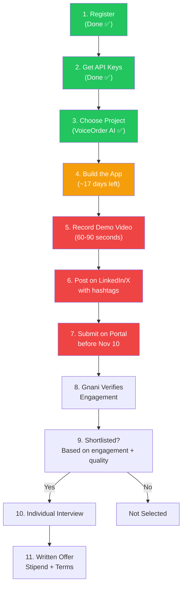
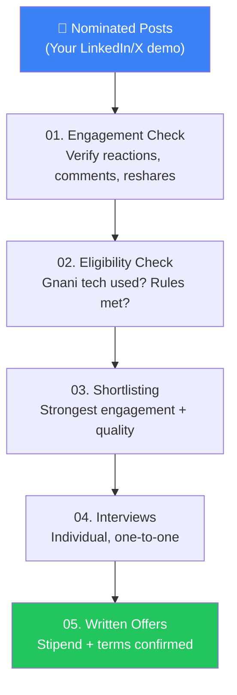

# 🔄 Workflow & Selection Process

## Complete Journey: Register → Build → Post → Submit → Interview → Offer

---

## Step-by-Step Details

### Step 1: Register ✅ (Done)

What you provided:
- Full name, email, and phone
- College name, degree or course, discipline
- Year of study, graduation year, and city
- Solo or team, and teammate's email (if applicable)

> Each teammate is deemed to accept the contest terms.

---

### Step 2: Build 🔨 (In Progress)

What you need to define:
- **Project title** — VoiceOrder AI
- **The problem you are solving** — Small shopkeepers taking orders verbally
- **Who will use it** — Kirana store owners and their customers
- **The Gnani AI models/APIs you use** — Prisma (STT), Timbre (TTS), Evon/LLM
- **Each member's contribution** — (if team)

> You can update these details until your final submission.

---

### Step 3: Post Your Demo 📹

| Requirement | Details |
|------------|---------|
| **Record** | A video of your application **actually working** |
| **Post** | On **LinkedIn**, **X (Twitter)**, or **both** |
| **Explain** | What you built and the Gnani AI technology used |
| **Tag** | Tag **Gnani AI** in the post |
| **Hashtags** | Add `#GreatIndianAIInternshipChallenge` and `#GnaniAI` |

> [!IMPORTANT]
> Tagging alone **doesn't complete** your entry. You nominate the post in Step 4 (Submit).

---

### Step 4: Submit 📤

Submit by **11:59 PM IST on November 10, 2026**:

- ✅ Your demo video
- ✅ A written project explanation
- ✅ The Gnani AI models/APIs you used
- ✅ One nominated post link per platform (LinkedIn and/or X)

---

## Selection Process Explained

The selection follows a **5-stage funnel**:

### Stage 1: Engagement Check
- Gnani AI verifies **reactions, comments, and reshares** on your nominated posts
- Engagement is recorded at the **closing cutoff** (Nov 10, 2026)
- Only **genuine engagement** counts — bought/fake engagement is filtered out

### Stage 2: Eligibility Check
- Entries must show **genuine use of Gnani AI technology**
- Must meet all **participation requirements** (student, 18+, etc.)

### Stage 3: Shortlisting
- Eligible projects with the **strongest verified engagement** are shortlisted
- Project quality and level of Gnani integration also matter

### Stage 4: Interviews
- Every shortlisted person interviews **on their own**
- Including **both members** of a team — individually
- One-to-one format

### Stage 5: Written Offers
- Offers and stipends depend on each candidate's:
  - **Assessed skills**
  - **Interview performance**
  - **Fit for available roles**
- Only a **written offer** confirms the internship

> [!WARNING]
> **Popular engagement on LinkedIn/X is a MAJOR selection factor.** Build something impressive, make a great demo video, and get genuine engagement from your network. This is not just about building — it's about presenting and promoting your work.

---

## What "Verified Engagement" Means

Gnani AI will check:

| Metric | What They Look For |
|--------|-------------------|
| **Reactions/Likes** | Real reactions from genuine LinkedIn/X profiles |
| **Comments** | Meaningful comments, not spam or bot-generated |
| **Reshares** | Authentic shares from your network |
| **Profile Quality** | Are the engaging accounts real people? |

What **doesn't count**:
- ❌ Bought likes or followers
- ❌ Bot-generated comments
- ❌ Engagement pod/swap activity
- ❌ Paid promotion to inflate metrics

---

## Tips for Maximizing Genuine Engagement

1. **Tell a compelling story** — Don't just show code; show the problem and solution
2. **Use a great demo video** — 60-90 seconds, clear, with real-world context
3. **Write a strong post** — Explain why it matters for Indian retailers
4. **Tag relevant people** — Your college, professors, friends in tech
5. **Share across platforms** — Post on both LinkedIn and X for maximum reach
6. **Engage with commenters** — Reply to every comment to boost algorithm visibility
7. **Post at optimal times** — Morning (8-10 AM IST) or evening (6-8 PM IST) for Indian audiences

---

*[← Rules & Eligibility](./02-rules-and-eligibility.md) | [Gnani Tech Stack →](./04-gnani-tech-stack.md)*
