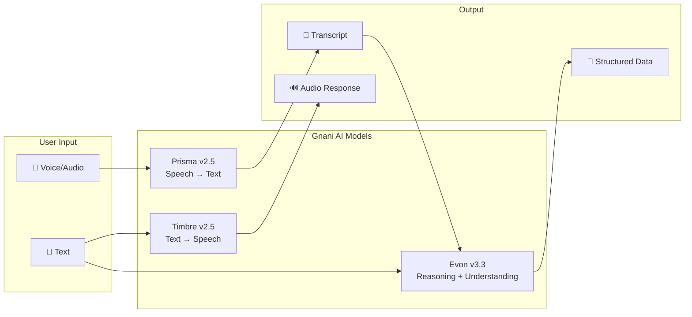

# 🛠️ Gnani AI Tech Stack — Models & Build Resources

## The Three Models

Gnani AI builds its own speech and language models, trained on real telephonic audio. They handle noisy calls, code-mixed speech, and Indian languages natively.

---

### 1. Prisma v2.5 — Speech-to-Text (STT)

| Property | Details |
|----------|---------|
| **Type** | Speech-to-Text |
| **Training Data** | 14M+ hours of Indian telephonic audio |
| **Latency** | Under 200ms (per Gnani's published benchmarks) |
| **Languages** | 10+ Indian languages + Hinglish, Tanglish, Benglish |
| **Strengths** | Noisy audio, code-mixed speech, Indian accents |
| **Access** | API via [app.gnani.ai](https://app.gnani.ai) |
| **API Docs** | [Speech to Text API](https://docs.gnani.ai) |

**What it does:**
- Takes spoken audio (microphone recording, audio file, phone call audio)
- Converts it to text (transcription)
- Handles Indian languages, mixed-language speech, and noisy environments

**Use cases in your project:**
- Customer speaks their order → Prisma converts it to text
- Shopkeeper records a customer's verbal order → gets a transcript

---

### 2. Timbre v2.5 — Text-to-Speech (TTS) *(Beta)*

| Property | Details |
|----------|---------|
| **Type** | Text-to-Speech |
| **Languages** | 10+ Indic languages |
| **Features** | Context-aware prosody, Indian names, numerals, lakh/crore cadence |
| **Streaming** | WebSocket and SSE |
| **Status** | **Beta** — check current availability |
| **Access** | API via [app.gnani.ai](https://app.gnani.ai) |
| **API Docs** | [Text to Speech API](https://docs.gnani.ai) |

**What it does:**
- Takes text input
- Generates natural-sounding speech audio in Indian languages
- Understands Indian number formats (lakh, crore), names, and context

**Use cases in your project:**
- Read the order summary back to the customer for confirmation
- Speak prices, totals, and delivery details aloud
- Accessibility — customers who can't read can hear the order

> [!WARNING]
> Timbre is in **Beta**. Verify current availability, supported languages, and any restrictions before building critical features around it. Always have a **text fallback**.

---

### 3. Evon v3.3 — Reasoning LLM (30B Parameters)

| Property | Details |
|----------|---------|
| **Type** | Reasoning / Large Language Model |
| **Parameters** | 30 billion (mixture-of-experts) |
| **Context** | 128K tokens |
| **Languages** | 11 Indian languages natively |
| **License** | Apache 2.0 (open weights) |
| **Access** | Hugging Face (by request) |
| **Release Notes** | [Evon v3.3 release notes](https://huggingface.co/gnani) |

**What it does:**
- Understands and reasons about text in Indian languages
- Can extract structured data from unstructured text
- Handles multilingual and code-mixed input

**Use cases in your project:**
- Extract product names, quantities, and units from messy transcripts
- Understand code-mixed orders ("do kilo chawal aur ek litre tel")
- Generate natural-language order summaries

> [!NOTE]
> Evon is available on Hugging Face by request. For the MVP, you can also use a compatible LLM (like OpenAI, Gemini) for structured extraction, but integrating Evon shows deeper Gnani commitment.

---

## How the Models Work Together



### The Pipeline in VoiceOrder AI

```
Customer speaks → [Prisma STT] → Raw transcript
                                       ↓
                              [Evon / LLM] → Extracted items (product, qty, unit)
                                       ↓
                              [Your Code] → Catalogue match + price lookup
                                       ↓
                              [Timbre TTS] → Spoken order summary
                                       ↓
                              [Customer] → Confirms or edits → Order saved
```

---

## Build Resources

| Resource | Details | Link |
|----------|---------|------|
| **API Credits** | 5,000 programme credits | Included with registration |
| **API Keys** | 3 free keys available | [API Dashboard](https://app.gnani.ai) |
| **API Dashboard** | Create keys, test voices, track usage | [app.gnani.ai](https://app.gnani.ai) |
| **Documentation** | API reference for STT, TTS, and streaming | [Gnani API Docs](https://docs.gnani.ai) |
| **Quick Start** | First transcription and synthesis call | [Quick Start Guide](https://docs.gnani.ai) |
| **Evon on HuggingFace** | Open weights, Apache 2.0 | [Hugging Face](https://huggingface.co/gnani) |
| **Model Overview** | Prisma, Timbre, Warp, Evon specs | [Models Page](https://www.gnani.ai) |
| **Discord Support** | Ask build questions, get help | Gnani AI Discord |

---

## Credit Usage Tips

- You have **5,000 credits** — use them wisely
- **Test with short audio clips** first to understand credit consumption
- **Cache transcription results** during development — don't re-transcribe the same audio
- **Use text input** for testing extraction logic (no credits needed)
- **Save Timbre credits** for the final demo and testing

---

## Important Integration Notes

> [!CAUTION]
> **Do NOT assume** Prisma or Timbre supports every Indian language, audio format, or streaming mode. Before coding:
> 1. **Verify** the current Gnani API documentation
> 2. **Check** your credentials, limits, and permitted use
> 3. **Build provider adapters** so the rest of the app doesn't depend on undocumented API behavior
> 4. **Test** with real audio in your target language before building the full flow

---

*[← Workflow & Selection](./03-workflow-and-selection.md) | [Platform & Tech Recommendations →](./05-platform-and-tech-recommendations.md)*
