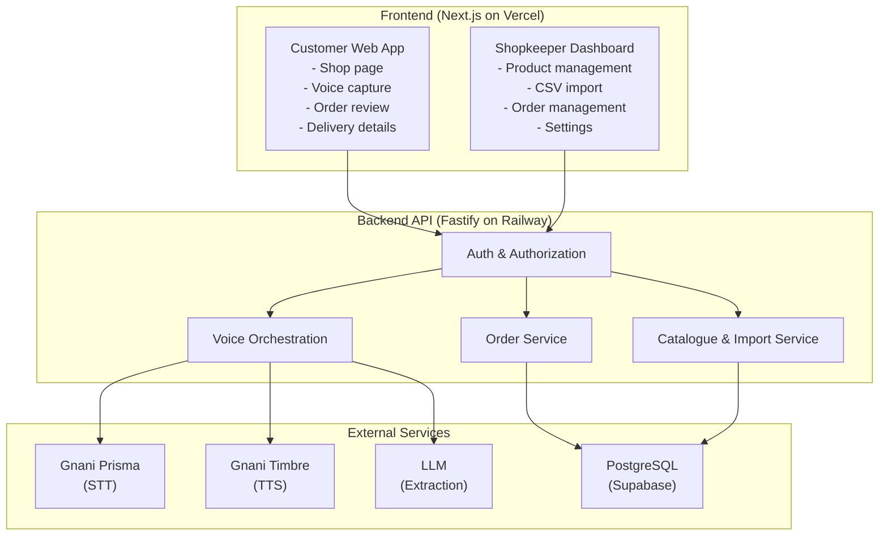

# 🖥️ Platform & Tech Recommendations

## Platform Comparison: What Should You Build?

| Platform | Pros | Cons | Best For |
|----------|------|------|----------|
| **Web App** ✅ Recommended | Works everywhere, no install needed, easy to demo, fast to build | Needs internet | Most challenge projects |
| **Mobile Web (PWA)** | Installable, offline-capable, mobile-first | More complex setup | Mobile-first experiences |
| **Native Mobile App** | Best device access, native feel | Slow to build, platform-specific, harder to demo | Only if you NEED native features |
| **Desktop App** | Good for admin dashboards | Limited audience, harder to share | Enterprise/admin tools |

---

## Why Web App Is the Best Choice for This Challenge

> [!TIP]
> For this challenge, a **responsive web app** is the BEST choice because:

| Reason | Why It Matters |
|--------|---------------|
| **Instant access** | Judges can open it via a URL — no install, no app store |
| **Easy to demo** | Record your screen, show it working — simple video |
| **Fastest to build** | 17 days is tight; web frameworks are the quickest path |
| **Microphone works** | Browser Web Audio API and MediaRecorder work for voice input |
| **Cross-device** | Works on mobile AND desktop with responsive design |
| **PWA upgrade path** | Can make it installable later if time permits |
| **Free hosting** | Vercel, Netlify, Railway all have free tiers |

---

## Recommended Tech Stack

### Frontend

| Layer | Technology | Why |
|-------|-----------|-----|
| **Framework** | Next.js (TypeScript) | Fast development, SSR, API routes, great ecosystem |
| **Styling** | Tailwind CSS | Rapid UI development, responsive by default |
| **State Management** | React Context + hooks | Simple enough for MVP |
| **Voice Recording** | Web Audio API / MediaRecorder | Browser-native, no extra library needed |
| **HTTP Client** | fetch or axios | API calls to backend |

### Backend

| Layer | Technology | Why |
|-------|-----------|-----|
| **API Server** | Fastify (TypeScript) | Fast, JSON Schema validation, lightweight |
| **Alternative** | Next.js API Routes | Simpler setup if using Next.js already |
| **Validation** | JSON Schema / Zod | Type-safe request/response validation |
| **File Upload** | Multipart/form-data | For audio and CSV uploads |

### Database

| Layer | Technology | Why |
|-------|-----------|-----|
| **Database** | PostgreSQL | Reliable, free on Supabase, great for structured data |
| **Hosting** | Supabase (managed Postgres) | Free tier, managed, built-in auth option |
| **ORM** | Prisma ORM or Drizzle | Type-safe database queries |
| **Migrations** | Version-controlled SQL | Safe schema changes |

### AI / Voice Services

| Layer | Technology | Why |
|-------|-----------|-----|
| **Speech-to-Text** | Gnani Prisma API | **Required** for the challenge |
| **Text-to-Speech** | Gnani Timbre API | Shows deeper Gnani integration |
| **LLM Extraction** | Gnani Evon or compatible LLM | Structured item extraction from transcripts |

### Hosting & Deployment

| Layer | Technology | Why |
|-------|-----------|-----|
| **Frontend** | Vercel | Free tier, optimized for Next.js |
| **Backend API** | Railway or Render | Free tier, persistent Node.js hosting |
| **Database** | Supabase | Free managed PostgreSQL |
| **Domain** | Optional (Vercel provides subdomain) | `.vercel.app` works for demo |

### Testing & Quality

| Layer | Technology | Why |
|-------|-----------|-----|
| **Unit Tests** | Vitest | Fast, TypeScript-native |
| **API Tests** | Integration tests with Vitest | Test API contracts |
| **E2E Tests** | Playwright | Browser automation, tests the full flow |
| **Error Monitoring** | Structured console logs (MVP) | Upgrade to Sentry later if needed |

---

## Architecture Overview

---

## Cost Breakdown (MVP)

| Service | Cost | Notes |
|---------|------|-------|
| **Vercel** | Free | Hobby plan, sufficient for demo |
| **Railway** | Free | Starter plan, 500 hours/month |
| **Supabase** | Free | Free tier: 500MB database |
| **Gnani APIs** | Free | 5,000 credits included |
| **Domain** | Free | Use `.vercel.app` subdomain |
| **LLM (if not Evon)** | Minimal | OpenAI/Gemini free tiers or low-cost API |
| **Total** | **₹0** | Entire MVP can be built for free |

---

## What NOT to Use (For This Challenge)

| ❌ Don't Use | Why |
|-------------|-----|
| Native mobile app (React Native, Flutter) | Too slow to build in 17 days |
| Microservices architecture | Overkill for MVP |
| Redis / Message queues | Unnecessary complexity |
| Docker / Kubernetes | Not needed for a demo |
| Custom ML model training | No time; use Gnani's models |
| Complex CI/CD pipelines | Manual deploy is fine for MVP |

---

*[← Gnani Tech Stack](./04-gnani-tech-stack.md) | [Gnani Integration Map →](./06-gnani-integration-map.md)*
