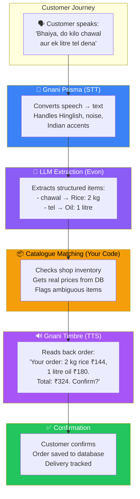

# 🎯 Gnani Integration Map — Where Each Model Is Used

## Overview: VoiceOrder AI Data Flow



---

## Detailed Integration Points

### 1. Voice Input → Text (Gnani Prisma)

| Aspect | Details |
|--------|---------|
| **Model** | Gnani Prisma v2.5 |
| **Type** | Speech-to-Text (STT) |
| **When Used** | Customer or shopkeeper speaks an order |
| **Input** | Audio file (recorded from browser microphone) |
| **Output** | Text transcript of the spoken words |
| **Why Gnani** | Trained on Indian telephonic audio; handles Hinglish, code-mixing, noise |

**Example:**
```
Input Audio:  "Bhaiya, do kilo chawal, ek litre tel aur paanch kilo aata bhej dena"
Prisma Output: "Bhaiya do kilo chawal ek litre tel aur paanch kilo aata bhej dena"
```

**Where in the app:**
- Customer Shop Page → "Speak Your Order" button
- Shopkeeper Dashboard → "Record Order" for a customer
- Both flows send audio to `POST /api/v1/voice/transcriptions`

---

### 2. Text Understanding → Structured Data (Evon / LLM)

| Aspect | Details |
|--------|---------|
| **Model** | Gnani Evon v3.3 or compatible LLM |
| **Type** | Reasoning / Structured Extraction |
| **When Used** | After transcript is corrected by user |
| **Input** | Corrected text transcript |
| **Output** | Structured JSON: items, quantities, units |
| **Why Gnani** | Evon understands 11 Indian languages natively |

**Example:**
```json
// Input text: "do kilo chawal ek litre tel aur paanch kilo aata"

// Evon/LLM Output:
{
  "items": [
    { "productQuery": "chawal", "quantity": 2, "unit": "kg" },
    { "productQuery": "tel", "quantity": 1, "unit": "litre" },
    { "productQuery": "aata", "quantity": 5, "unit": "kg" }
  ]
}
```

**Where in the app:**
- Extracted Order Review screen
- Backend endpoint: `POST /api/v1/voice/extract-items`

---

### 3. Order Readback → Spoken Summary (Gnani Timbre)

| Aspect | Details |
|--------|---------|
| **Model** | Gnani Timbre v2.5 |
| **Type** | Text-to-Speech (TTS) |
| **When Used** | After items are matched and totals calculated |
| **Input** | Generated summary text with prices and totals |
| **Output** | Audio file (spoken summary) |
| **Why Gnani** | Indian language prosody, lakh/crore cadence, Indian names |

**Example:**
```
Input Text:  "Aapka order: 2 kilo chawal 144 rupaye, 1 litre tel 180 rupaye.
              Delivery charge 30 rupaye. Total 354 rupaye. Confirm karein?"

Timbre Output: [Audio file with natural Indian speech]
```

**Where in the app:**
- Final Confirmation screen → "Listen to Order Summary" button
- Shopkeeper reads order to customer over phone
- Backend endpoint: `POST /api/v1/voice/speak`

---

### 4. Catalogue Matching & Price Lookup (Your Code — NOT Gnani)

| Aspect | Details |
|--------|---------|
| **Model** | **None** — this is your application logic |
| **When Used** | After LLM extracts items |
| **Input** | Extracted product queries (e.g., "chawal", "tel") |
| **Output** | Matched products with real prices from database |
| **Why NOT AI** | Prices must come from the shop's database, never from AI guesses |

**Example:**
```
Extracted: "chawal" → Matches "Rice 1 kg" (SKU: RIC-001) → ₹72/kg
Extracted: "tel"   → Matches "Cooking Oil 1L" (SKU: OIL-001) → ₹180/litre
```

> [!CAUTION]
> **AI does NOT decide prices.** The database is the source of truth. AI only helps identify what the customer wants — the catalogue provides the real price.

---

### 5. Price Calculation & Order Creation (Your Code — NOT Gnani)

| Aspect | Details |
|--------|---------|
| **Model** | **None** — server-side calculation |
| **What** | Line totals, subtotal, delivery fee, grand total |
| **Rule** | All prices are integer paise, calculated server-side |
| **Why NOT AI** | Financial calculations must be deterministic and auditable |

---

## Summary: What Is Gnani vs What Is Your Code

| Step | Who Does It | Gnani Model | Your Code |
|------|-------------|-------------|-----------|
| Record audio | Browser | — | MediaRecorder API |
| Audio → Text | Gnani | **Prisma** ✅ | Provider adapter |
| Display & edit transcript | Your app | — | React component |
| Text → Structured items | Gnani/LLM | **Evon** ✅ | JSON parsing + validation |
| Match items to catalogue | Your app | — | Database query + fuzzy match |
| Calculate prices | Your app | — | Server-side math (paise) |
| Speak order summary | Gnani | **Timbre** ✅ | Provider adapter |
| Customer confirmation | Your app | — | UI + database transaction |
| Save order | Your app | — | PostgreSQL transaction |
| Track delivery | Your app | — | Status machine + updates |

---

## Integration Architecture

```
┌─────────────────────────────────────────────────────────┐
│                    YOUR APPLICATION                       │
│                                                           │
│  ┌──────────┐    ┌──────────┐    ┌──────────────────┐   │
│  │ Frontend  │───▶│ Backend  │───▶│ Provider Adapters │   │
│  │ (Next.js) │    │ (Fastify)│    │                    │   │
│  └──────────┘    └──────────┘    │  ┌──────────────┐ │   │
│                       │           │  │ gnani-prisma │ │───▶ Gnani Prisma API
│                       │           │  └──────────────┘ │   │
│                       │           │  ┌──────────────┐ │   │
│                       │           │  │ gnani-timbre │ │───▶ Gnani Timbre API
│                       │           │  └──────────────┘ │   │
│                       │           │  ┌──────────────┐ │   │
│                       │           │  │ llm-extractor│ │───▶ Evon / LLM API
│                       ▼           │  └──────────────┘ │   │
│                  ┌──────────┐    └──────────────────┘   │
│                  │PostgreSQL│                             │
│                  └──────────┘                             │
└─────────────────────────────────────────────────────────┘
```

Each Gnani model is accessed through a **provider adapter** — a thin wrapper that:
1. Sends the request in the format the Gnani API expects
2. Maps the Gnani response into a normalized format your app understands
3. Handles errors, timeouts, and retries
4. Makes it easy to swap providers if needed

---

*[← Platform & Tech Recommendations](./05-platform-and-tech-recommendations.md) | [Project Ideas & Awards →](./07-project-ideas-and-awards.md)*
