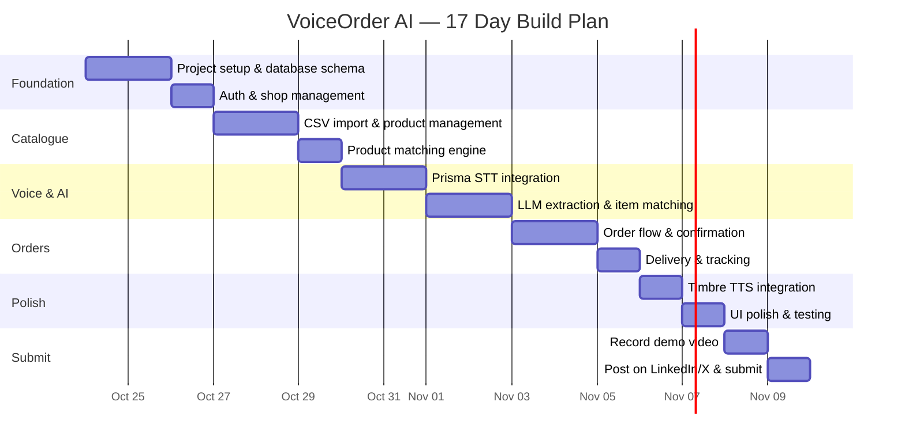

# 🗓️ Timeline & Action Plan

## Key Dates

| Date | Event | Status |
|------|-------|--------|
| **Oct 1, 2026** | Contest started, registration opened | ✅ Done |
| **Oct 24, 2026** | Today | 🟡 **17 days left** |
| **Nov 10, 2026** | ⚠️ **DEADLINE** — 11:59 PM IST, no extensions | 🔴 Upcoming |
| After close | Interviews for shortlisted participants | ⏳ Pending |
| **Jan 1, 2027** | Internships start (6 months, scheduled) | ⏳ Pending |

---

## Build Timeline

| Period | Duration |
|--------|----------|
| **Build window** | 41 days total (Oct 1 – Nov 10) |
| **Remaining** | ~17 days |
| **Review & interviews** | After close |
| **Internship** | 6 months (Jan 1, 2027) |

---

## 17-Day Build Schedule

---

## Day-by-Day Breakdown

### 📦 Days 1-3 (Oct 24-26): Foundation & Catalogue

| Day | Tasks |
|-----|-------|
| **Day 1** | Project setup (Next.js + Fastify + PostgreSQL). Database schema & migrations. Seed demo data. |
| **Day 2** | Authentication for shopkeeper. Shop settings. CSV import & validation. |
| **Day 3** | Product management CRUD. Product search. Catalogue matching engine (name, aliases, fuzzy). |

**Deliverable:** A shopkeeper can sign in, import a CSV catalogue, and manage products.

---

### 🎤 Days 4-7 (Oct 27-30): Voice & AI Integration

| Day | Tasks |
|-----|-------|
| **Day 4** | Gnani Prisma adapter. Audio recording in browser. Upload & transcribe endpoint. |
| **Day 5** | Transcript display & editing UI. Language selector. Error handling for STT failures. |
| **Day 6** | LLM extraction adapter. Structured item extraction from corrected text. JSON parsing & validation. |
| **Day 7** | Catalogue matching from extracted items. Ambiguity resolution UI. Clarification prompts. |

**Deliverable:** A customer can speak an order, see the transcript, correct it, and see matched catalogue items.

---

### 🛒 Days 8-10 (Oct 31-Nov 2): Order Flow & Delivery

| Day | Tasks |
|-----|-------|
| **Day 8** | Quote calculation (server-side prices). Order review screen. Quantity editing. |
| **Day 9** | Delivery address form. Delivery fee calculation. Final confirmation screen. |
| **Day 10** | Idempotent order creation. Order history. Order status transitions. Shopkeeper order management. |

**Deliverable:** Complete order flow — voice → items → prices → address → confirm → saved order.

---

### ✨ Days 11-13 (Nov 3-5): Polish & Timbre

| Day | Tasks |
|-----|-------|
| **Day 11** | Gnani Timbre integration. Spoken order summary on confirmation screen. Fallback to text. |
| **Day 12** | UI polish — responsive design, loading states, error states, empty states. Mobile testing. |
| **Day 13** | End-to-end testing. Fix bugs. Test with real Hinglish audio. Edge case testing. |

**Deliverable:** Polished, tested app with Timbre readback working (or graceful fallback).

---

### 📹 Days 14-15 (Nov 6-7): Demo & Recording

| Day | Tasks |
|-----|-------|
| **Day 14** | Plan demo script (60-90 seconds). Set up demo data. Practice recording. Record first take. |
| **Day 15** | Review and re-record if needed. Edit video. Prepare LinkedIn/X post text. Deploy to production. |

**Deliverable:** A polished 60-90 second demo video showing the full working flow.

---

### 🚀 Days 16-17 (Nov 8-9): Submit

| Day | Tasks |
|-----|-------|
| **Day 16** | Post demo video on LinkedIn with hashtags. Post on X with hashtags. Share with network. |
| **Day 17** | Complete submission form on Gnani portal. Nominate LinkedIn/X post links. Final checks. |

**Deliverable:** Public demo posted, submission completed, all requirements met.

> [!CAUTION]
> **Submit by Nov 9** to give yourself a buffer. Don't wait until 11:59 PM on Nov 10!

---

## Priority Rules

### If Time Gets Tight

> Ship a **complete and trustworthy voice-to-order flow** for a smaller verified set of languages rather than a broad language selector that doesn't work end to end.

### Must-Have vs Nice-to-Have

| Priority | Feature | Status |
|----------|---------|--------|
| 🔴 **Must** | CSV catalogue import with validation | Required |
| 🔴 **Must** | Voice input → Prisma transcription | Required |
| 🔴 **Must** | Transcript editing by user | Required |
| 🔴 **Must** | Item extraction and catalogue matching | Required |
| 🔴 **Must** | Server-side price calculation | Required |
| 🔴 **Must** | Explicit order confirmation | Required |
| 🔴 **Must** | Order saved to database | Required |
| 🔴 **Must** | Shopkeeper dashboard with order list | Required |
| 🟡 **Should** | Timbre TTS readback | Important but has text fallback |
| 🟡 **Should** | Delivery address & tracking | Important for completeness |
| 🟡 **Should** | Ambiguity resolution UI | Shows AI maturity |
| 🟢 **Nice** | Multiple language support | Test at least Hindi + Hinglish |
| 🟢 **Nice** | PWA / installable app | Only if time permits |
| 🟢 **Nice** | Customer account system | Guest checkout is fine for MVP |

---

## What You Should Do RIGHT NOW

1. **Set up the project** — `npx create-next-app` + database setup
2. **Create the database schema** — all tables for products, orders, customers
3. **Seed demo catalogue** — a small set of kirana products with Hindi aliases
4. **Test your Gnani API keys** — make sure Prisma works with a simple audio file
5. **Start coding** — begin with catalogue import, then voice integration

---

## Submission Checklist

Before submitting, verify every item:

- [ ] Working public demo deployed and tested on mobile and desktop
- [ ] Prisma integration verified against the real Gnani service
- [ ] Timbre integration verified if claimed in the submission
- [ ] Catalogue import, ambiguity handling, confirmation, and delivery flow demonstrated
- [ ] Public demo video posted on LinkedIn or X
- [ ] Both `#GnaniAI` and `#GreatIndianAIInternshipChallenge` included in post
- [ ] Project explanation and real-world problem statement prepared
- [ ] Exact models and APIs used documented
- [ ] Individual contribution accurately described
- [ ] Required nominated post links and submission fields completed
- [ ] Eligibility and challenge terms checked against the official portal

---

## Summary Table

| Question | Answer |
|----------|--------|
| **What is this?** | AI internship challenge by Gnani AI — build with their models, win internships + awards |
| **What do I build?** | Anything using Gnani models. You chose **VoiceOrder AI** ✅ |
| **Platform?** | **Web app** (responsive, mobile-first) — best for demo + accessibility |
| **Tech stack?** | Next.js + Fastify + PostgreSQL + Gnani Prisma/Timbre/Evon |
| **Where is Gnani used?** | Speech→Text (Prisma), Text→Speech (Timbre), Reasoning (Evon) |
| **How am I selected?** | Engagement on LinkedIn/X → Shortlist → Interview → Written offer |
| **Deadline?** | **November 10, 2026, 11:59 PM IST** |
| **Stipend?** | Up to ₹1 lakh/month for 6 months |
| **Your project strength?** | Eligible for 6+ award categories, uses all 3 Gnani models, highly relatable |

---

> **Your VoiceOrder AI is an excellent choice. Now focus on building and shipping it in 17 days. Good luck, Rajan!** 🚀

---

*[← Why VoiceOrder AI](./08-why-voiceorder-ai.md) | [VoiceOrder AI: Project Overview →](./10-project-overview.md)*
