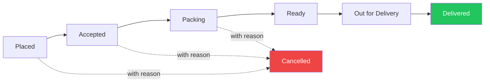

# 📋 Order Lifecycle, History & Ratings

Order status and payment status are tracked **separately**, because an order can be delivered but still unpaid.

---

## Order Status Flow

| Order Status | Who Sets It | What the Customer Sees |
|-------------|------------|----------------------|
| **Placed** | Created after confirmation | "Order received" |
| **Accepted** | Shopkeeper | "Shop accepted your order" |
| **Packing** | Shopkeeper | "Being packed" |
| **Ready** | Shopkeeper | "Ready for pickup" or "Ready to go" |
| **Out for delivery** | Shopkeeper or helper | "On the way" |
| **Delivered** | Helper or shopkeeper | "Delivered"; rating requested |
| **Cancelled** | Shopkeeper with a reason, or the customer before the shop accepts | "Cancelled" with the reason |

### Rules

- A **delivered order cannot go back** to an earlier status
- Every change is **logged** with who made it and when
- Stock is **returned** when an order is cancelled before dispatch

---

## Order History

| For | What They Can See |
|-----|------------------|
| **Customer** | Past orders, status, bills and payment state. A guest uses the tracking link; a returning phone number can see its orders after a one-time check. An **Order again** button copies the items, with prices and stock re-checked |
| **Shopkeeper** | All orders with filters for date, status, payment and customer; a page per customer with total orders, total spent, unpaid balance, last order and frequently ordered items; a daily summary with order count, sales, and cash, UPI and credit totals |
| **Delivery helper** | Only today's orders to deliver, the address, and the **Delivered** button |

---

## Ratings

- After an order is **Delivered**, the customer is asked once for **1 to 5 stars** and an optional comment about items and delivery
- Only a **real delivered order** can be rated, which stops fake ratings
- In the MVP, ratings are **private to the shop**: the shopkeeper sees the average and recent comments and can reply
- Customers are **not rated publicly**. The shopkeeper may keep a private note on a customer, such as "pays on the 1st", visible only to the shop

---

*[← Billing & Payments](./15-billing-and-payments.md) | [Screens & UI →](./17-screens-and-ui.md)*
